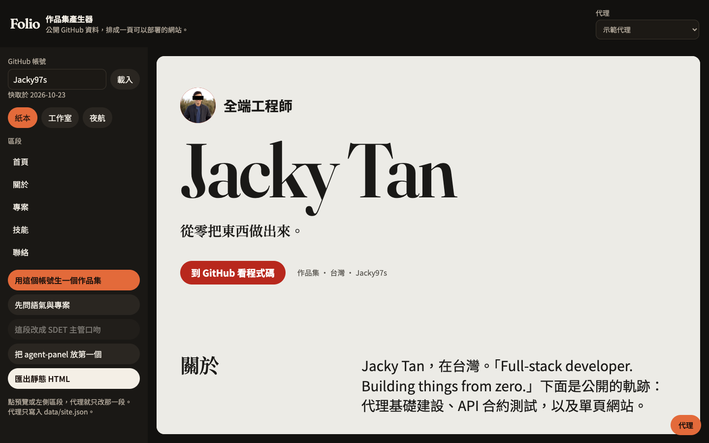
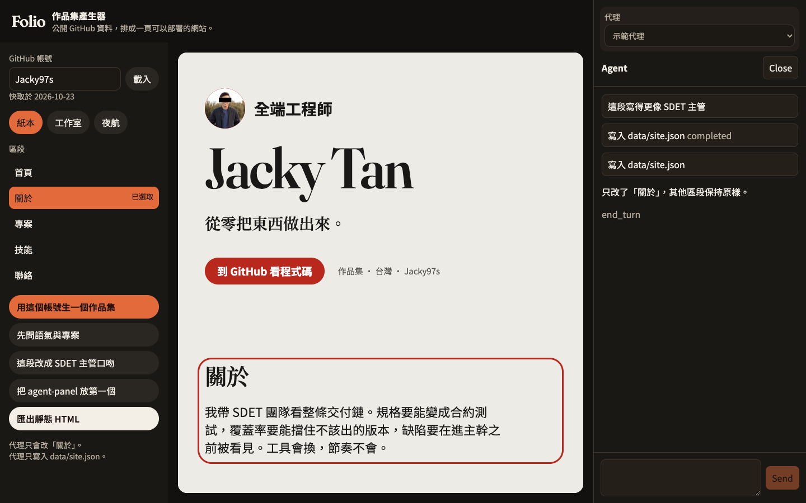
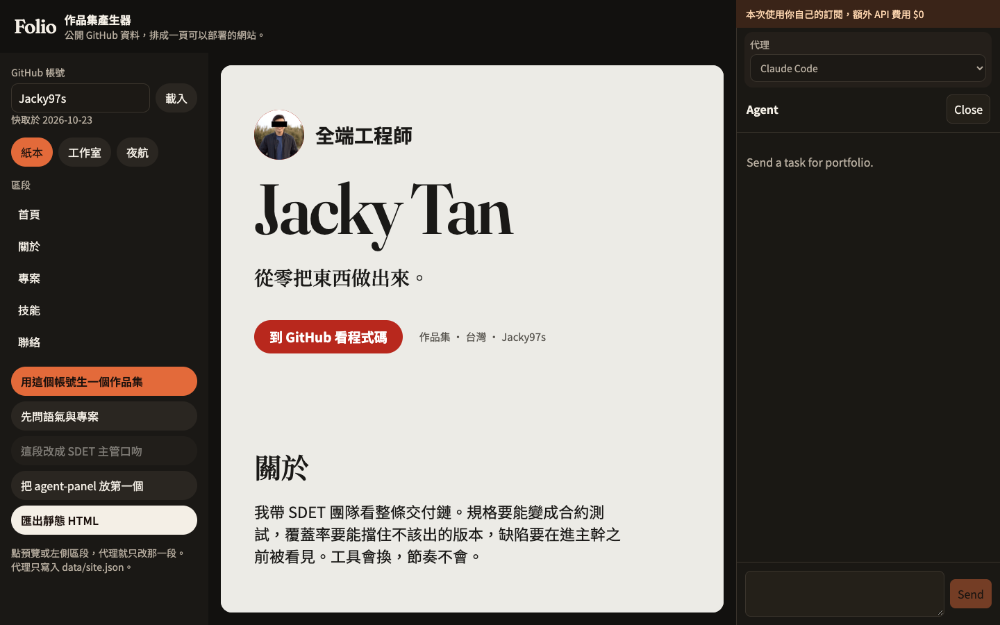
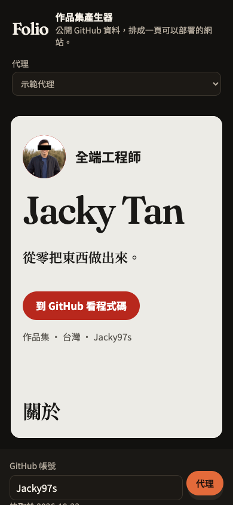

# 作品集產生器

輸入一個 GitHub 帳號，把公開的個人資料與專案排成一頁作品集。預覽會跟著 `data/site.json` 更新，也可以匯出成單一靜態 HTML。

代理面板用 [agent-panel](https://github.com/Jacky97s/agent-panel) 接上你自己的 Claude Code 或 Codex。沒有安裝代理時，內建的示範 peer 一樣能把頁面寫出來。



內建範例是 [Jacky97s](https://github.com/Jacky97s)。快取已經放在 `data/github/`，打開就能看。

## 怎麼操作

1. 左側輸入 GitHub 帳號，按「載入」。公開的 profile、repo 與 README 會寫進 `data/github/`。
2. 按「用這個帳號生一個作品集」。示範代理會先問語氣、語言，以及要放上首頁的專案。
3. 點預覽或左側的區段，再說「這段寫得更像 SDET 主管」。代理只改那一段。
4. 「把 agent-panel 放第一個」會調整精選專案的順序。
5. 主題可以在「紙本」「工作室」「夜航」之間換，不必經過代理。
6. 「匯出靜態 HTML」寫入 `dist-site/index.html`，那個檔案可以單獨部署。

右下角的「代理」會打開面板，預設是關著的。面板上方可以切換示範代理、Claude Code、Codex。





切到 Claude Code 或 Codex 時，面板上方會顯示：「本次使用你自己的訂閱，額外 API 費用 $0」。

## 怎麼接上 agent-panel

框架放在 submodule `vendor/agent-panel`，釘在 `cursor/agent-panel-v1-fef3` 的 commit `c47a6717a68e731e0ac5db653679650249aad6d7`。這個分支已經併進 agent-panel 的 main，遠端分支已刪，所以 submodule 指到該 commit。三個套件以 pnpm workspace 連結，沒有把框架原始碼複製進這個 app。

| 機制 | 這個 app 怎麼用 |
| --- | --- |
| Capability | `portfolio`：系統提示、`buildContext`、`onComplete` 由 Vite plugin 註冊 |
| 可寫入目錄 | 只有 `data/`。代理讀 GitHub 快取，寫 `data/site.json` |
| 允許的工具 | 讀寫類名稱（`read` / `write` / `edit` 等）。不允許 `Bash` 或 `shell` |
| 選取即上下文 | 點到的區段以 `section` 與 `selection` 字串送進 prompt |
| 提問卡 | 語氣、語言、要放的專案。示範 peer 用 ACP form elicitation |
| 即時預覽 | 代理寫入後，頁面看到 result 事件就重讀 `site.json` |
| 自己的訂閱 | `ACP_PRESETS['claude-code']` 與 `ACP_PRESETS.codex` |

採用說明也在 `skills/`（從框架的 `add-skills` 內容而來）。

## 執行

需要 Node 20.19 以上與 pnpm 10。

```bash
git clone --recurse-submodules https://github.com/Jacky97s/agent-panel-portfolio.git
cd agent-panel-portfolio
pnpm install
pnpm dev
```

若 clone 時沒有帶 submodule：

```bash
git submodule update --init
```

瀏覽器開 http://127.0.0.1:5173 。

### 示範代理

預設就是這一個。它不呼叫模型，會讀 `data/github/` 的快取，寫出合法的 `data/site.json`，也會發出提問卡與寫入許可卡。測試走這條路。

### Claude Code

面板的代理選單選 Claude Code。開發伺服器會重啟並改接：

```bash
npx -y @agentclientprotocol/claude-agent-acp
```

需要本機已經登入 Claude Code。

### Codex

選單選 Codex，對應：

```bash
npx -y @agentclientprotocol/codex-acp
```

選單的選擇寫在 `data/runtime-agent.json`（不進版控）。刪掉那個檔案就回到示範代理。

## 測試

```bash
pnpm exec playwright install chromium   # 第一次跑 e2e 前
pnpm test
```

`pnpm test` 先跑單元測試，再跑 Playwright。單元測試含一輪真正走過 ACP 的示範 peer。Playwright 會開一個用 `e2e/.data` 副本的開發伺服器，用示範代理改一段「關於」，再回答一張提問卡，確認預覽跟著變。只想跑其中一半時用 `pnpm test:unit` 或 `pnpm test:e2e`。

手機版：



## 框架限制

這些是 agent-panel 目前沒有、這個 demo 在外面補上的行為：

- 一個開發伺服器只綁一個 ACP 行程。切換代理會重啟 Vite。
- 面板內建文字是英文，例如 Send、Close、`end_turn`、`completed`、「Send a task for portfolio.」，也沒有提供翻譯參數。浮動按鈕用 CSS 顯示成「代理」，但它的無障礙名稱仍是 Agent。
- 從瀏覽器送進能力的 context 只留字串、數字與布林，巢狀物件會被丟掉，單一字串大約到 4000 字。所以選取內容是字串。
- 可寫入目錄同時管讀與寫。要讀快取，根目錄就得包含整個 `data/`；提示詞再限制只能寫 `site.json`。
- 內建的 `mockAgentPath()` 只認得範例筆記。這裡另有一個會寫作品集的示範 peer。
- `allowedTools` 用工具名稱比對。名稱不在清單裡會直接拒絕。這裡沒有放行 shell。
