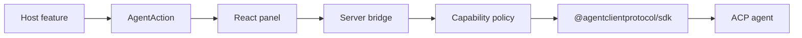

# agent-panel

Embed a small agent panel in any app and hand a feature's task to an [Agent Client Protocol](https://agentclientprotocol.com) agent.

ACP, [`@tutti-os/agent-acp-kit`](https://www.npmjs.com/package/@tutti-os/agent-acp-kit), and [acp-components](https://github.com/Endlessworld/acp-components) already cover agent backends and a full ACP workbench. [open-slide](https://github.com/open-slide/open-slide) showed an in-app panel wired to one product. agent-panel is the layer in between: a capability registry, writable-root and tool policy, and a thin panel. The agent process is whoever speaks ACP.



## Quick start

```bash
pnpm install
pnpm build
pnpm --filter example-basic dev
```

The example spawns `mockAgentPath()`, an ACP peer with no model. It revises `examples/basic/sandbox/note.md`, asks a tone question, and writes `sandbox/generated.txt`. No Claude, Codex, or Gemini CLI is required for that demo.

To use a real agent, pass a preset from `@agent-panel/core/acp`:

```ts
import { ACP_PRESETS } from '@agent-panel/core/acp';
import { agentPanel } from '@agent-panel/server/vite';

export default defineConfig({
  plugins: [
    agentPanel({
      agent: ACP_PRESETS['claude-code'],
      writableRoots: ['sandbox'],
      capabilities: [
        {
          id: 'note',
          label: 'Markdown note',
          systemPromptAppend: 'Edit the note the user has open.',
          writableRoots: ['sandbox'],
          allowedTools: ['write'],
          buildContext: (ctx) => [`Current file: ${String(ctx.file ?? 'sandbox/note.md')}`],
          onComplete: ({ stopReason }) => {
            if (stopReason === 'end_turn') console.log('note turn finished');
          },
        },
      ],
    }),
  ],
});
```

```tsx
import { AgentAction, AgentDock, AgentPanelRoot } from '@agent-panel/react';
import '@agent-panel/react/styles.css';

export function App() {
  return (
    <AgentPanelRoot>
      <AgentAction capability="note" prompt="Tighten the note.">
        Revise the note
      </AgentAction>
      <AgentDock capabilityId="note" />
    </AgentPanelRoot>
  );
}
```

## Why this shape

| Piece | Role |
| --- | --- |
| `@agentclientprotocol/sdk` | Stable ACP v1 client. Sessions, prompts, permissions, filesystem, and form elicitation stay in the protocol. |
| ACP adapters | `ACP_PRESETS` spawns `@agentclientprotocol/claude-agent-acp`, `@agentclientprotocol/codex-acp`, or `gemini --experimental-acp`. |
| `@tutti-os/agent-acp-kit` | Optional. It detects and launches many local agents. Pass the command it would spawn. agent-panel does not reimplement that catalog. |
| acp-components | A full ACP workbench. This panel is a dock, a transcript, a composer, question cards, and permission cards. |
| open-slide | The reference for an in-app panel. The capability id replaces a slide id. The ACP agent replaces the Claude and Codex runners. |

Writable roots are enforced on `fs/read_text_file` and `fs/write_text_file`. `allowedTools` rejects permission requests for other tool names. `onComplete` runs in the host process when the turn stops. The browser reloads from the `result` event.

## Write a capability

See `skills/create-capability/SKILL.md`. A capability is `id`, `label`, `systemPromptAppend`, `writableRoots`, `allowedTools`, `buildContext`, and `onComplete`. Context from a button (`selection`, `file`, `element`, `state`) is appended inside `<agent-panel-capability>` because ACP prompts are content blocks.

## Connect an agent

See `skills/connect-acp-agent/SKILL.md`.

```ts
import { ACP_PRESETS } from '@agent-panel/core/acp';

ACP_PRESETS['claude-code']; // npx -y @agentclientprotocol/claude-agent-acp
ACP_PRESETS.codex; // npx -y @agentclientprotocol/codex-acp
ACP_PRESETS.gemini; // gemini --experimental-acp
```

Any other stdio agent is `{ command, args }`. Tests can pass `{ app: createDemoAgent() }` and skip the process.

## Skills

Skills live only in the top-level `skills/` directory.

| Skill | What it covers |
| --- | --- |
| `integrate-agent-panel` | Packages, Vite plugin, panel, WebSocket |
| `create-capability` | Prompt, roots, tools, context, onComplete |
| `connect-acp-agent` | Claude Code, Codex, Gemini CLI, custom ACP command |
| `troubleshoot-agent-panel` | Connection, permissions, roots, questions |

Install them into another project with either a copy or:

```bash
pnpm exec agent-panel add-skills
pnpm exec agent-panel init
```

`add-skills` and `init` copy those four directories into `./skills`. They do not write `.claude/skills` or `.agents/skills`. If your agent only scans one of those folders, copy or symlink there yourself.

## Scripts

```bash
pnpm build
pnpm test
pnpm typecheck
pnpm lint
```

pnpm workspaces, Turborepo, Biome, Vitest, TypeScript strict. Node 20.19 or newer.

## 繁體中文

agent-panel 是放在 Agent Client Protocol 之上的能力層。ACP、agent-acp-kit 與 acp-components 已經負責代理程式後端與完整工作台，這裡只做每項功能的 capability：系統提示、可寫入目錄、允許的工具、上下文，以及完成後的回呼。面板透過 WebSocket 把 ACP 的 session update、權限請求與提問表單顯示出來。

本機沒有 Claude、Codex 或 Gemini 時，範例會啟動內建的 ACP demo agent。接上真實代理時，把 `agent` 換成 `ACP_PRESETS['claude-code']`、`ACP_PRESETS.codex` 或 `ACP_PRESETS.gemini`。技能檔只放在頂層 `skills/`，安裝指令是 `pnpm exec agent-panel add-skills`。

## License

MIT. See [LICENSE](LICENSE) and [NOTICE](NOTICE).
